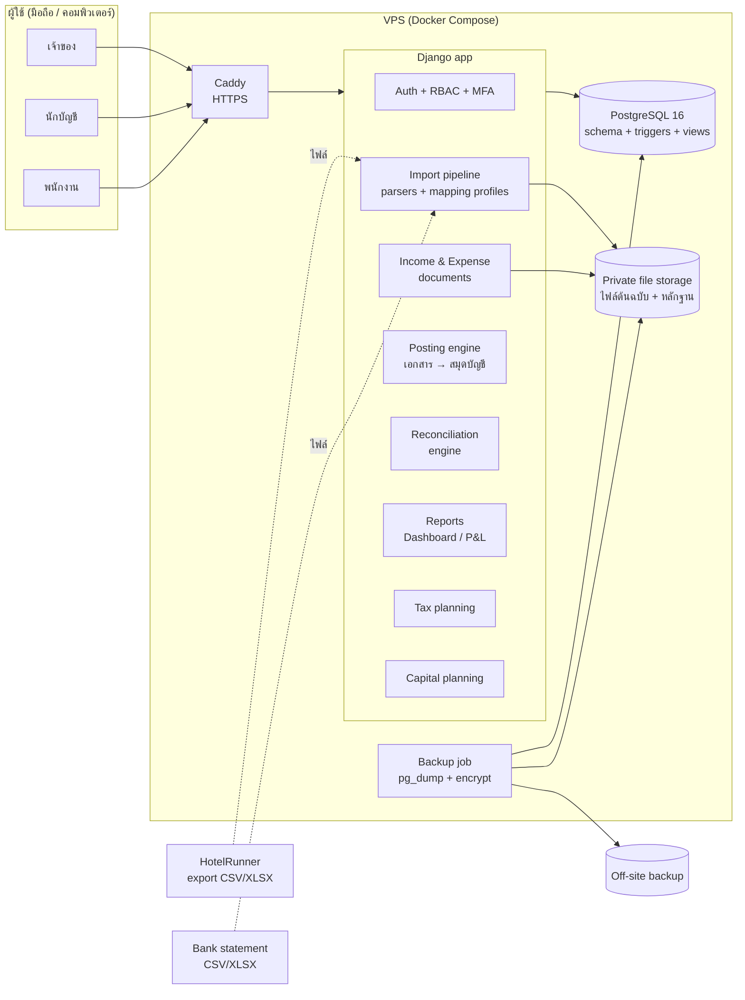
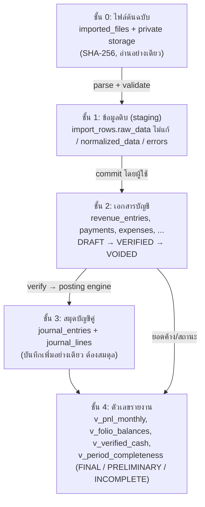
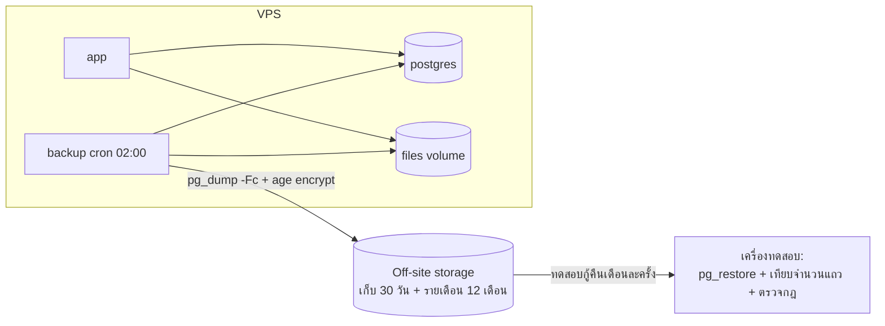

# 2. System Architecture

## 2.1 หลักการออกแบบ

1. **ข้อมูลเป็นชั้น ไม่ข้ามชั้น** — ไฟล์ต้นฉบับ → แถวข้อมูลดิบ → เอกสารบัญชี (ร่าง/ยืนยัน) → สมุดบัญชีคู่ → รายงาน ตัวเลขทุกตัวบนหน้าจอย้อนกลับไปหาไฟล์ต้นฉบับได้
2. **ฐานข้อมูลเป็นผู้คุมกฎ** — กฎที่ผิดไม่ได้ (ห้ามแก้รายการที่ยืนยันแล้ว, กันซ้ำ, งบดุลต้องสมดุล, ล็อกงวด, Audit Log) อยู่ใน PostgreSQL constraint/trigger แอปทุกตัว (เว็บ, สคริปต์, admin) จึงข้ามไม่ได้
3. **ไม่มีตัวเลขที่ไม่มีที่มา** — ไม่มี mock data ใน production, ประมาณการทุกตัวติดป้าย, รายงานบอกความครบถ้วนเสมอ
4. **คนตัดสินใจ ระบบเสนอ** — การจับคู่อัตโนมัติ, หมวดรายจ่ายจาก PMS, ค่าคอมประมาณการ ต้องมีคนยืนยัน
5. **เรียบง่ายต่อการดูแล** — แอปเดียว ฐานข้อมูลเดียว deploy ด้วยคำสั่งเดียว เหมาะกับกิจการขนาดเล็กที่ไม่มีทีม IT

## 2.2 Technology stack ที่แนะนำ (รอยืนยัน)

| ส่วน | เลือก | เหตุผล |
|---|---|---|
| ฐานข้อมูล | **PostgreSQL 16** | NUMERIC แม่นยำ, constraint/trigger/deferred constraint สำหรับกฎบัญชี, JSONB สำหรับข้อมูลดิบ — schema ใน Phase 1 ทดสอบกับ PG16 แล้ว |
| Backend + หน้าเว็บ | **Python 3.12 + Django 5.2 LTS** (server-rendered + HTMX) | มี Login/Session/CSRF/สิทธิ์/Admin/แปลภาษาในตัว, `Decimal` เป็นมาตรฐาน, ไลบรารีอ่าน Excel/CSV/PDF ครบ (openpyxl, pdfplumber), secret อยู่ฝั่ง server ทั้งหมด |
| CSS / มือถือ | Tailwind CSS (build ตอน deploy) | responsive โดยไม่ต้องมีแอป frontend แยก |
| งานเบื้องหลัง | ทำใน request สำหรับไฟล์เล็ก; คิวงานใน PostgreSQL (`django-q2`/`procrastinate`) เมื่อไฟล์ใหญ่ | ไม่ต้องมี Redis |
| ไฟล์หลักฐาน/ไฟล์ต้นฉบับ | Object storage แบบ private (S3-compatible เช่น Cloudflare R2/Backblaze B2) หรือ volume บนเครื่องเดียวกัน | ไม่มี URL สาธารณะ เปิดผ่าน endpoint ที่ตรวจสิทธิ์ |
| Deploy | Docker Compose: `app` + `postgres` + `caddy` (HTTPS อัตโนมัติ) บน VPS ภูมิภาคสิงคโปร์/ไทย | เครื่องเดียวพอสำหรับ 15–30 ห้อง |
| สำรองข้อมูล | `pg_dump -Fc` รายวัน + เข้ารหัส (age) + ส่งออกนอกเครื่อง + sync ไฟล์ storage, ทดสอบกู้คืนรายเดือน | ซ้อมแล้วใน Phase 1 (`web/db/tools/backup-restore-drill.sh`) |

ทางเลือกอื่นที่พิจารณา: Next.js + Supabase (ได้ auth/storage สำเร็จรูป แต่ตรรกะบัญชีจะกระจายไปอยู่ทั้ง TypeScript และ SQL policy ดูแลยากกว่า) — **แนะนำ Django** ถ้าเจ้าของไม่มีเหตุผลเรื่องผู้ดูแลระบบ/ค่าใช้จ่ายที่ต่างออกไป

**การจัดการ schema**: SQL ใน `web/db/schema/` เป็นต้นฉบับ (trigger/constraint ทั้งหมดอยู่ที่นี่และมีชุดทดสอบ) — ใน Phase 2 Django models จะตั้ง `managed = False` และมีเทสต์เทียบ models กับ schema จริง การเปลี่ยน schema ทำเป็นไฟล์ migration SQL ลำดับถัดไป (`010_...sql`) ห้ามแก้ไฟล์เก่าหลัง go-live

## 2.3 ภาพรวมองค์ประกอบ



## 2.4 ชั้นข้อมูล (Data layers)



ข้อมูลต้นฉบับจากการนำเข้า (ชั้น 0–1) แยกจากข้อมูลบัญชีที่ตรวจสอบแล้ว (ชั้น 2 สถานะ VERIFIED และชั้น 3) ตามที่ requirement กำหนด

## 2.5 โมดูล → องค์ประกอบ → ตาราง

| โมดูล | องค์ประกอบในแอป | ตาราง/วิว |
|---|---|---|
| A Dashboard | Reports | `v_pnl_monthly`, `v_verified_cash`, `v_folio_balances`, `v_payment_allocation_status`, `v_expense_payment_status`, `tax_estimates`, `v_capital_goal_progress`, `v_period_completeness` |
| B Income & Expense | Documents, Posting engine | `revenue_entries`, `payments`, `payment_allocations`, `expenses`, `expense_payments`, `fund_transfers`, `attachments`, `attachment_links` |
| C Import | Import pipeline | `import_mapping_profiles`, `imported_files`, `import_rows`, `reservations`, `folios`, `pms_daily_statistics` |
| D Bank reconciliation | Reconciliation engine | `bank_transactions`, `reconciliations`, `reconciliation_items`, `v_bank_transaction_status`, `v_book_reconciliation_status` |
| E Profit & Loss | Posting engine, Reports | `journal_entries`, `journal_lines`, `ledger_accounts`, `fixed_assets`, `accounting_periods`, `v_pnl_lines`, `v_pnl_monthly` |
| F Tax | Tax planning | `tax_profiles`, `tax_rules`, `tax_estimates` |
| G Capital | Capital planning | `capital_goals`, `capital_scenarios`, `capital_fund_transactions`, `loans`, `balance_confirmations` |
| ความปลอดภัย | Auth/RBAC | `users`, `roles`, `user_property_roles`, `audit_logs` |

## 2.6 สิทธิ์ผู้ใช้ (RBAC)

✅ = ทำได้, 👁 = ดูได้อย่างเดียว, — = ไม่ได้

| การกระทำ | OWNER | ACCOUNTANT | MANAGER | FRONT_DESK | VIEWER |
|---|---|---|---|---|---|
| ดู Dashboard / P&L / ภาษี | ✅ | ✅ | ✅ | — | 👁 |
| ดูแผนเงินทุน | ✅ | ✅ | — | — | 👁 |
| อัปโหลดรายงาน PMS / หลักฐาน | ✅ | ✅ | ✅ | ✅ | — |
| ยืนยันนำเข้าไฟล์ (commit) | ✅ | ✅ | ✅ | — | — |
| บันทึกรายการร่าง (DRAFT) | ✅ | ✅ | ✅ | ✅ | — |
| ยืนยันรายการ (VERIFY) | ✅ | ✅ | — | — | — |
| ยกเลิกรายการ (VOID) พร้อมเหตุผล | ✅ | ✅ | — | — | — |
| เสนอการจับคู่ธนาคาร | ✅ | ✅ | ✅ | — | — |
| ยืนยันการจับคู่ / ยกเลิกการจับคู่ | ✅ | ✅ | — | — | — |
| ปิดงวด | ✅ | ✅ | — | — | — |
| เปิดงวดที่ปิดแล้ว | ✅ | — | — | — | — |
| ตั้งค่าภาษี / ยืนยันนโยบายภาษี | ✅ | ✅ | — | — | — |
| ตั้งเป้าหมาย/นโยบายเงินสำรอง/scenario | ✅ | — | — | — | — |
| จัดการผู้ใช้และสิทธิ์ | ✅ | — | — | — | — |
| ดู Audit Log | ✅ | ✅ | — | — | — |
| สำรอง/กู้คืนข้อมูล | ✅ (ผ่านผู้ดูแลระบบ) | — | — | — | — |

- **Maker–checker**: ผู้ที่สร้างรายการไม่ควรเป็นผู้ยืนยันรายการเดียวกัน — ถ้ากิจการมีผู้ใช้คนเดียว ระบบอนุญาตแต่บันทึกใน Audit Log ว่า "ยืนยันรายการของตัวเอง" (ต้องยืนยันนโยบาย — ไฟล์ 07)
- การตรวจสิทธิ์ทำใน backend ทุก request (ไม่พึ่งการซ่อนปุ่มใน UI) และมีเทสต์ตามตารางนี้ใน Phase 8

## 2.7 ความปลอดภัย

| หัวข้อ | การออกแบบ |
|---|---|
| Login | อีเมล + รหัสผ่าน (argon2id), ล็อกชั่วคราวเมื่อผิดติดกัน (`users.failed_login_count`, `locked_until`), MFA แบบ TOTP บังคับ OWNER/ACCOUNTANT |
| Session | cookie `Secure`, `HttpOnly`, `SameSite=Lax`, หมดอายุเมื่อไม่ใช้งาน, CSRF token ทุกฟอร์ม |
| Secrets | อยู่ใน environment ของ server / secret store เท่านั้น — ไม่มี API key ใน HTML/JS (แอป Android เดิมเก็บ key ในเครื่อง ระบบใหม่ไม่ทำแบบนั้น) |
| ฐานข้อมูล | แอปใช้ role `app_rw` (SELECT/INSERT/UPDATE/DELETE เท่านั้น ไม่มี TRUNCATE/ALTER/สิทธิ์ปิด trigger); migration ใช้ role `app_owner` แยก; superuser ใช้เฉพาะผู้ดูแลระบบ |
| Audit | trigger บันทึกทุกการเปลี่ยนแปลงพร้อม `app.user_id`, `app.reason`, IP, request id; การเข้าระบบ/ล้มเหลว/ส่งออก/สำรอง/กู้คืน บันทึกโดยแอป |
| ไฟล์ | ตรวจชนิดไฟล์จากเนื้อไฟล์ (ไม่ใช่นามสกุล), จำกัด 25 MB, เก็บด้วยชื่อสุ่ม, ดาวน์โหลดผ่าน endpoint ที่ตรวจสิทธิ์, ไม่เปิดไฟล์ Excel ที่มี macro |
| การนำเข้า | อ่านค่า cell ไม่ประเมินสูตร, กันการฉีดสูตรเมื่อส่งออก CSV (ขึ้นต้นด้วย `= + - @` ใส่ `'` นำหน้า — บทเรียนจากแอปเดิม) |
| PDPA | เก็บชื่อแขกเท่าที่จำเป็น, ไม่เก็บเบอร์โทร/เลขบัตร, ไฟล์ต้นฉบับ PMS ที่มีข้อมูลแขกเก็บใน private storage ตามระยะที่นักบัญชีกำหนด |
| HTTPS | Caddy ออกใบรับรองอัตโนมัติ, HSTS |
| ข้อมูลทดสอบ | `properties.is_sandbox = true` แอปแสดงแถบ "ข้อมูลทดสอบ" ชัดเจน; สคริปต์ deploy production ไม่โหลด fixture ทดสอบ |

## 2.8 การ deploy และสำรองข้อมูล



ผลซ้อมกู้คืนใน Phase 1: dump แบบ custom-format กู้คืนด้วย `pg_restore` ธรรมดาได้ครบทั้ง 40 ตาราง, งวดที่ปิดยังเป็น FINAL, ทุก journal สมดุล, trigger ทำงานครบหลังกู้คืน (pg_dump สร้าง trigger หลังโหลดข้อมูล จึงไม่ยิงซ้ำและ Audit Log ไม่ถูกสร้างซ้ำ) — ถ้าเป็นการกู้คืนแบบ **data-only** ต้องใช้ `--disable-triggers`

## 2.9 ความสัมพันธ์กับแอป Android เดิม

| เรื่อง | ข้อเสนอ |
|---|---|
| การใช้งานคู่กัน | ระหว่าง Phase 2–7 แอป Android ใช้งานต่อได้ตามเดิม ระบบเว็บเริ่มเป็นสมุดบัญชีหลักตั้งแต่ `properties.accounting_start_date` ที่ตกลงกัน |
| ย้ายข้อมูล | ทางเลือก: (ก) เริ่มใหม่ด้วยยอดยกมาที่นักบัญชีรับรอง ณ วันเริ่ม (แนะนำ — ตรวจสอบง่าย) หรือ (ข) นำเข้าประวัติจากไฟล์สำรองของแอป (`source_system = 'ANDROID_APP'`) เป็นรายการ DRAFT ให้ตรวจ |
| กระเป๋าเงิน 9 ใบ (MAKE by KBank) | ในระบบใหม่เป็น `bank_accounts` (ถ้าแต่ละกระเป๋ามี statement แยก) หรือเป็นการกันเงินภายใน — ต้องยืนยันว่า MAKE ออก statement แยกกระเป๋าได้หรือไม่ |
| ตัวอ่านรายงาน eZee | ใช้เป็นข้อมูลอ้างอิงโครงสร้างรายงานและกรณีทดสอบ (ไฟล์ 06) |

## 2.10 โครงสร้างโฟลเดอร์ (ปัจจุบันและที่วางแผน)

```
web/
├── README.md                     ภาพรวมและสถานะแต่ละ Phase
├── docs/phase-1/                 เอกสาร Phase 1 (ไฟล์นี้)
└── db/
    ├── schema/001–009_*.sql      DDL + trigger + views (ต้นฉบับของ schema)
    ├── reference/*.sql           ข้อมูลอ้างอิงที่ใช้จริง: บทบาท, ผังบัญชีร่าง, หมวดรายจ่าย
    ├── tests/*.sql               ชุดทดสอบกฎในฐานข้อมูล
    ├── tools/                    สร้าง data dictionary, ซ้อมสำรอง/กู้คืน
    ├── apply.sh                  สร้าง schema ในฐานข้อมูลว่าง
    └── run-tests.sh              สร้างฐานข้อมูลทดสอบใหม่แล้วรันทุกเทสต์
# Phase 2+ (วางแผน)
    ├── app/                      Django project (apps: accounts, imports, documents, ledger, recon, reports, tax, capital)
    ├── docker/                   Dockerfile, compose, Caddyfile
    └── fixtures/                 ไฟล์รายงานตัวอย่างที่ติดป้าย [TEST] / ไม่มีข้อมูลส่วนบุคคล
```
