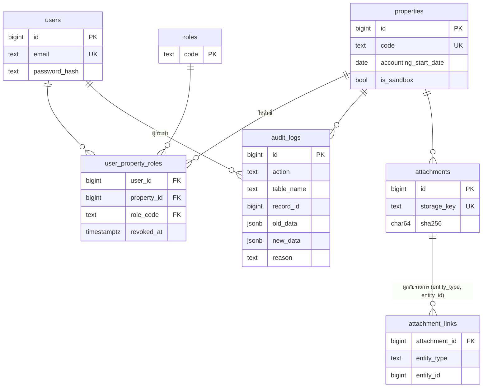
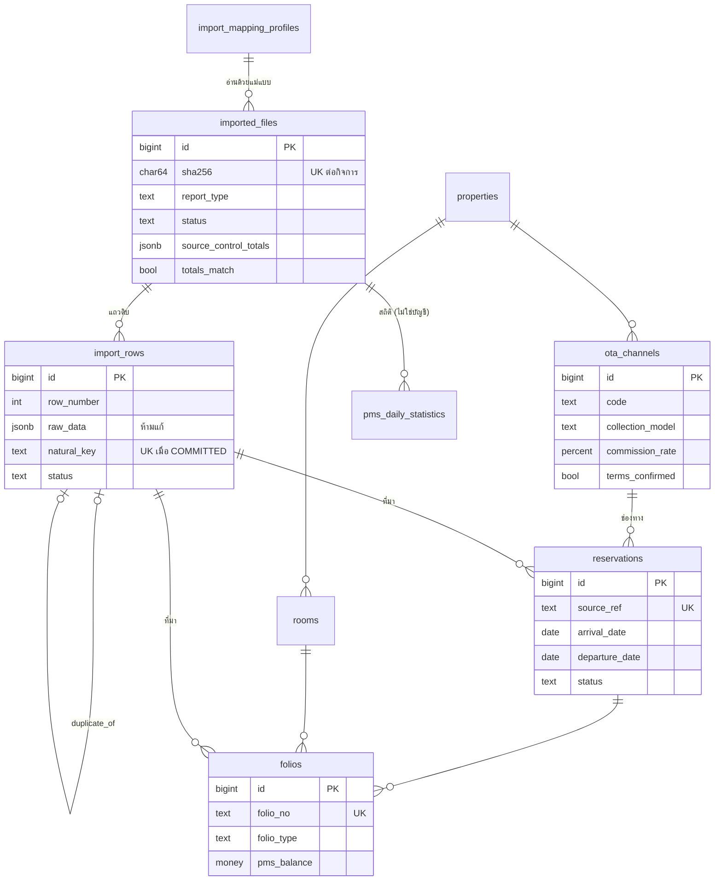
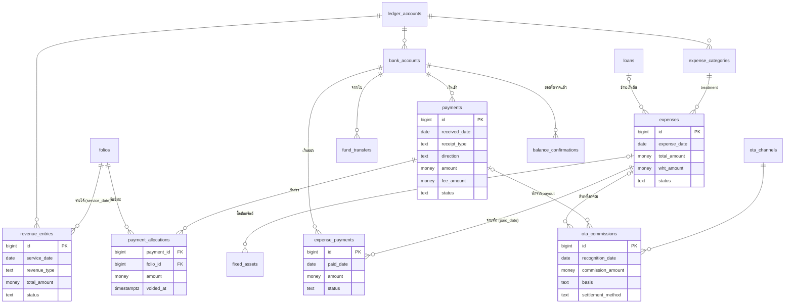
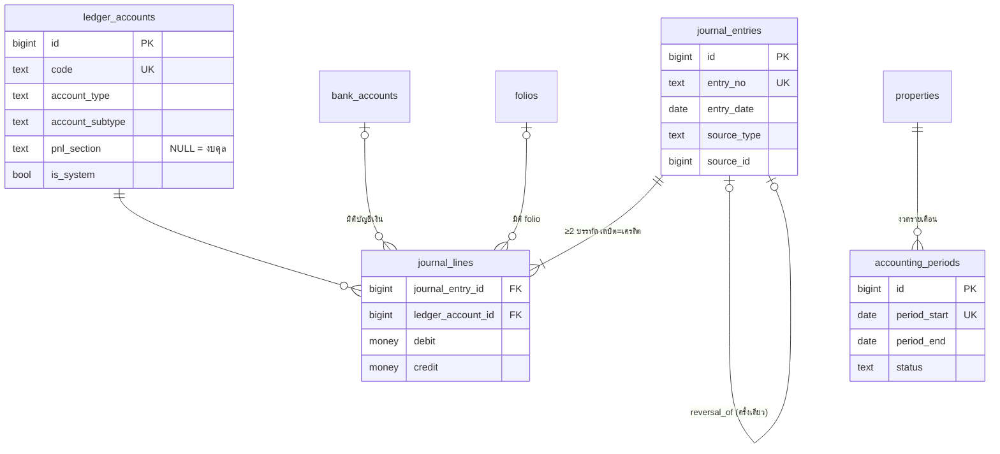
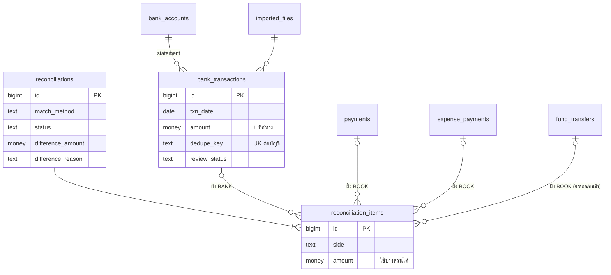
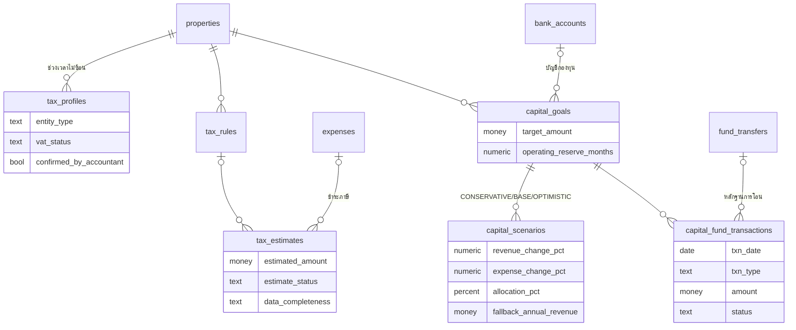
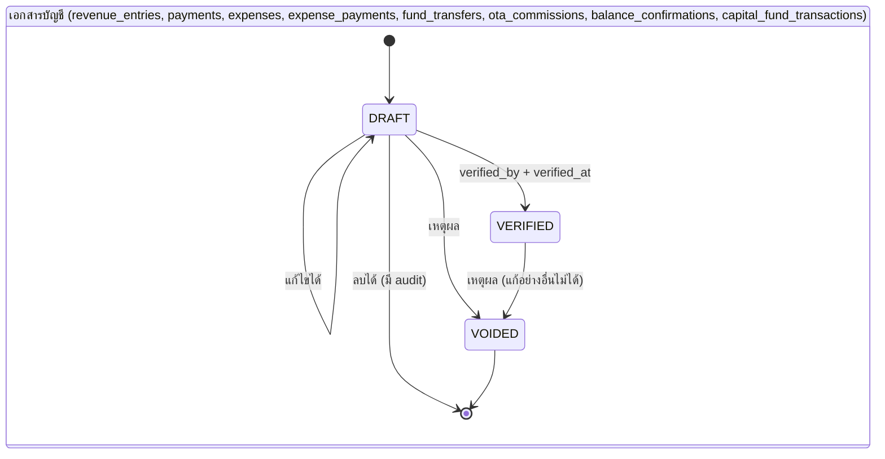

# 3. Database Schema

- ต้นฉบับที่รันได้จริง: [`web/db/schema/`](../../db/schema) (PostgreSQL 16) — 40 ตาราง, 10 views, ทุกคอลัมน์มีคำอธิบาย
- รายละเอียดทุกคอลัมน์ (ชนิดข้อมูล, Null, ค่าเริ่มต้น, PK/FK, ดัชนีกันซ้ำ, trigger): [04-data-dictionary.md](04-data-dictionary.md) (สร้างอัตโนมัติจาก schema)
- ข้อมูลอ้างอิงที่ใช้จริง: [`web/db/reference/`](../../db/reference) — บทบาท 5 แบบ, **ผังบัญชีร่าง** 50 บัญชี, หมวดรายจ่าย 25 หมวด (นักบัญชีต้องยืนยัน)

## 3.1 ข้อกำหนดร่วม (conventions)

| เรื่อง | กำหนด |
|---|---|
| Primary key | `id bigint GENERATED ALWAYS AS IDENTITY` ทุกตาราง (ยกเว้น `roles.code`) |
| เงิน | domain `money_thb` = `NUMERIC(14,2)` (สูงสุด ±999,999,999,999.99) — เทสต์ยืนยันว่าไม่มีคอลัมน์ float และคอลัมน์เงินทุกคอลัมน์เป็น NUMERIC(14,2) |
| อัตรา % | domain `percent_rate` = `NUMERIC(7,4)` 0–100 |
| วันที่ | `date` สำหรับวันทางธุรกิจ (ค.ศ.), `timestamptz` สำหรับเวลาเกิดเหตุการณ์ |
| สถานะ/ประเภท | `text` + `CHECK (... IN (...))` แทน enum เพื่อเพิ่มค่าได้ง่าย |
| ข้อความบังคับ | `has_text(x)` ใน CHECK (เทสต์พบว่า `length(trim(x)) > 0` ปล่อย NULL ผ่าน จึงห้ามใช้) |
| หลายกิจการ | ทุกตารางธุรกรรมมี `property_id`; trigger ตรวจว่ารายการที่อ้างถึงกันเป็นของกิจการเดียวกัน (AC008) |
| Audit | trigger `trg_<table>_audit` บนทุกตารางธุรกิจ → `audit_logs` |
| รหัสข้อผิดพลาด | `AC001` แก้ไม่ได้ (ล็อก) · `AC002` งวดปิดแล้ว · `AC003` บัญชีไม่สมดุล · `AC004` เกินยอด/ยอดไม่ตรง · `AC005` ใช้บัญชี/ประเภทผิด · `AC006` ห้ามลบ · `AC007` ปิดงวดไม่ได้ · `AC008` ข้ามกิจการ — แอปแปลงเป็นข้อความภาษาไทย |

## 3.2 แผนภาพความสัมพันธ์ (ERD) แยกตามส่วน

### ก. ผู้ใช้ กิจการ Audit และไฟล์หลักฐาน

### ข. ข้อมูลจาก PMS และการนำเข้า

### ค. เอกสารบัญชี (รายได้ เงินรับ รายจ่าย)

### ง. สมุดบัญชีคู่และงวดบัญชี

### จ. กระทบยอดธนาคาร

### ฉ. ภาษีและแผนเงินทุน

## 3.3 วงจรสถานะ (state machines) ที่ฐานข้อมูลบังคับ

| วัตถุ | สถานะ | กฎ |
|---|---|---|
| `imported_files` | UPLOADED → PARSED/PARSE_FAILED → VALIDATED → COMMITTED หรือ REJECTED | COMMITTED ต้อง `totals_match` ไม่เป็น false; COMMITTED/REJECTED เปลี่ยนต่อไม่ได้; ลบไม่ได้; ไฟล์เดียวกัน (SHA-256) ซ้ำไม่ได้ยกเว้นตัวเดิมถูก REJECTED |
| `import_rows` | PENDING → VALID/INVALID/DUPLICATE/CONFLICT → COMMITTED/SKIPPED/SUPERSEDED | `raw_data`, `natural_key`, `row_hash` แก้ไม่ได้; ลบไม่ได้; `natural_key` COMMITTED ได้ครั้งเดียว |
| `reconciliations` | PROPOSED → CONFIRMED → REVERSED, หรือ PROPOSED → REJECTED | สร้างได้เฉพาะ PROPOSED; ยืนยันได้เมื่อ ฝั่งธนาคาร − ฝั่งบัญชี = `difference_amount` (≠0 ต้องมีเหตุผล) และรายการฝั่งบัญชีเป็น VERIFIED; รายการในชุดเพิ่ม/ลบได้เฉพาะตอน PROPOSED |
| `accounting_periods` | OPEN ⇄ CLOSED | สร้างได้เฉพาะ OPEN; ปิดได้เมื่อ `issue_count = 0` และงวดก่อนหน้าปิดแล้ว; เปิดใหม่ต้องมีผู้เปิด/เวลา/เหตุผล และเปิดย้อนจากงวดล่าสุด; งวดที่ปิดแก้ไม่ได้; ลบไม่ได้ |
| `tax_estimates` | SYSTEM_ESTIMATE → ACCOUNTANT_REVIEWED → FILED → PAID (หรือ CANCELLED) | FILED แก้ได้เฉพาะข้อมูลการชำระ; PAID/CANCELLED ถาวร; ลบได้เฉพาะ SYSTEM_ESTIMATE |
| `journal_entries/lines` | — | บันทึกเพิ่มอย่างเดียว; ตรวจสมดุลตอน COMMIT (deferred); แก้ด้วย REVERSAL ได้ครั้งเดียวต่อรายการ |
| `audit_logs`, `attachments` | — | บันทึกเพิ่มอย่างเดียว (ห้าม UPDATE/DELETE/TRUNCATE) |

## 3.4 สิ่งที่ฐานข้อมูลรับประกัน (และมีเทสต์)

| การรับประกัน | กลไก | เทสต์ |
|---|---|---|
| ไม่มีจำนวนเงินแบบ float | domain + เทสต์ catalog | `01` |
| นำเข้าไฟล์เดิมซ้ำไม่สร้างรายการซ้ำ | unique (property, sha256), unique natural_key เมื่อ COMMITTED, unique (property, source_system, source_ref) ของเอกสารที่ยังไม่ VOIDED | `04` |
| ข้อมูลดิบไม่สูญหาย | ห้ามแก้ `raw_data`, ห้ามลบแถว/ไฟล์, แถว INVALID เก็บพร้อม error | `04` |
| รายได้แยกจากเงินรับ | ตารางแยก เชื่อมผ่าน allocation ที่ไม่เกินยอด | `05` |
| ค่าใช้จ่ายไม่ถูกนับซ้ำ | treatment ↔ ประเภทบัญชี, ห้ามใช้บัญชีระบบ, ค่าคอมล้างหนี้ด้วยหมวดเฉพาะ | `06`, `07` |
| บัญชีสมดุล | deferred constraint trigger | `07` |
| กระทบยอดไม่สร้างเงิน | ตารางจับคู่อ้างถึงรายการที่มีอยู่เท่านั้น, ใช้ไม่เกินยอดจริง | `08` |
| กำไร "ยืนยันแล้ว" เฉพาะงวดที่ข้อมูลครบและปิดแล้ว | `v_period_completeness` + trigger ปิดงวด | `09` |
| Audit Trail ครบและแก้ไม่ได้ | trigger + append-only | `02` |
| ข้อมูลข้ามกิจการไม่ได้ | `assert_same_property` | `03`, `10` |

## 3.5 ดัชนี (indexes)

- ดัชนีตามวันที่ทางธุรกิจต่อกิจการ: `(property_id, service_date)`, `(property_id, received_date)`, `(property_id, expense_date)`, `(property_id, txn_date)` — ใช้กับรายงานรายวัน/เดือน/ปีและการตรวจความครบถ้วน
- ดัชนีกันซ้ำ (unique, บางตัวเป็น partial): ดูหัวข้อ "Unique" ของแต่ละตารางใน data dictionary
- ดัชนีจับคู่: `bank_transactions (bank_account_id, amount, txn_date)` สำหรับเสนอการจับคู่ยอดเท่ากันวันใกล้กัน
- ดัชนี FK ที่ใช้ join บ่อย: `revenue_entries.folio_id`, `payment_allocations.folio_id`, `expense_payments.expense_id`, `reconciliation_items.*`

## 3.6 การเปลี่ยนแปลง schema หลัง go-live

1. เพิ่มไฟล์ใหม่ `web/db/schema/0NN_<desc>.sql` (ไม่แก้ไฟล์เดิม)
2. ทุกคอลัมน์ใหม่ต้องมี COMMENT (เทสต์ `01` จะล้มถ้าไม่มี) และสร้าง data dictionary ใหม่
3. รัน `run-tests.sh` + ซ้อมกู้คืน ก่อน deploy; สำรองข้อมูลก่อน migrate ทุกครั้ง
