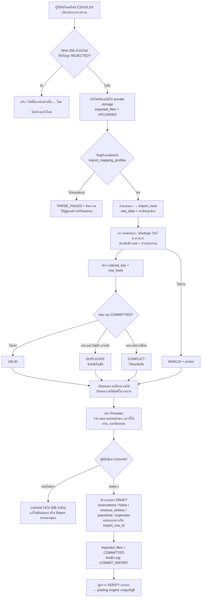
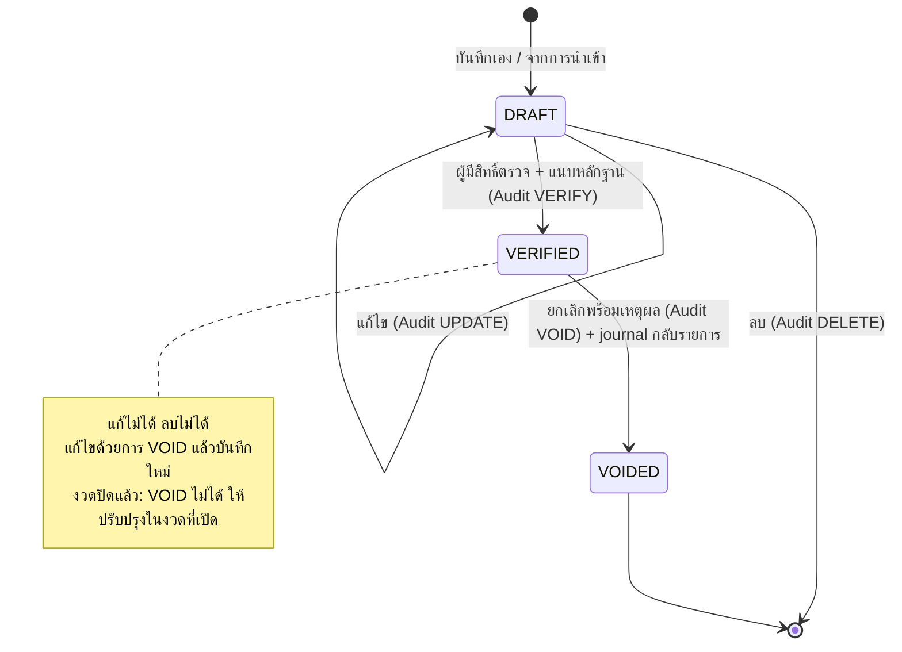
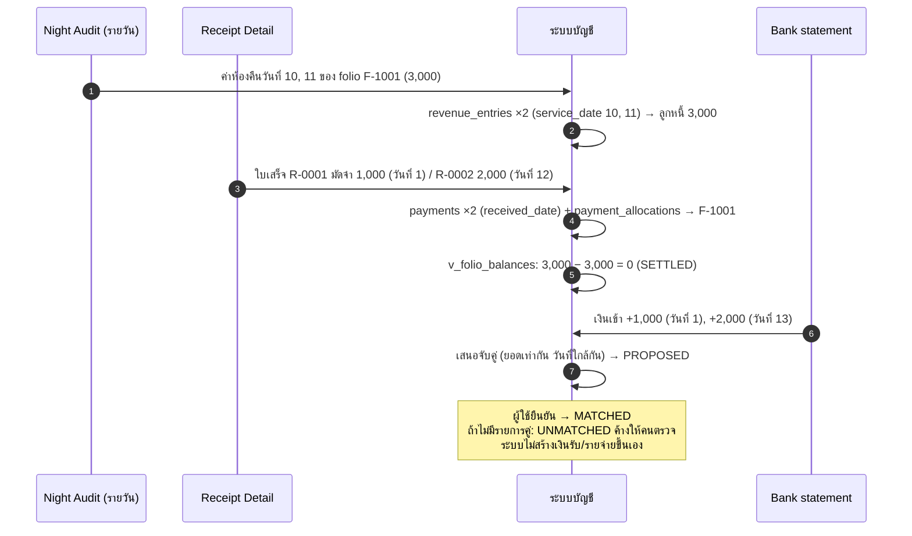
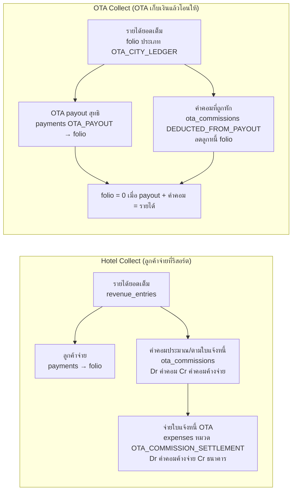
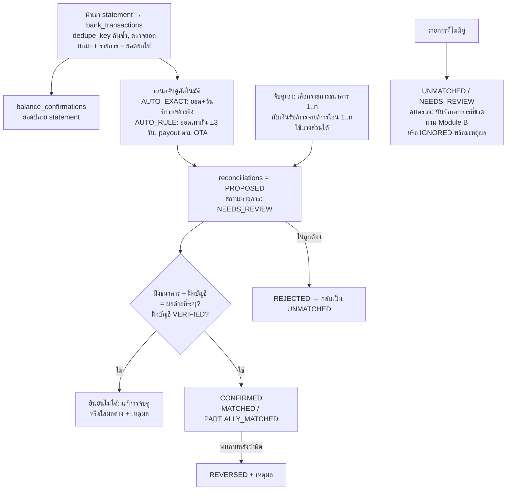
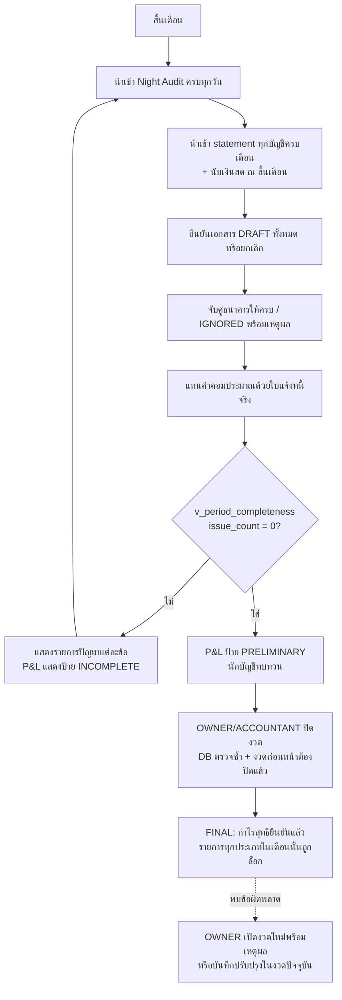
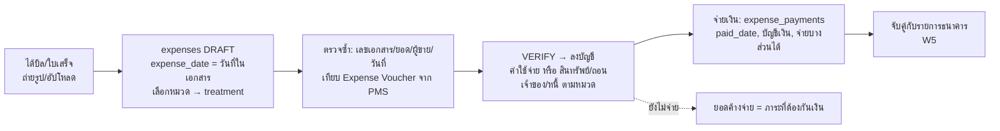
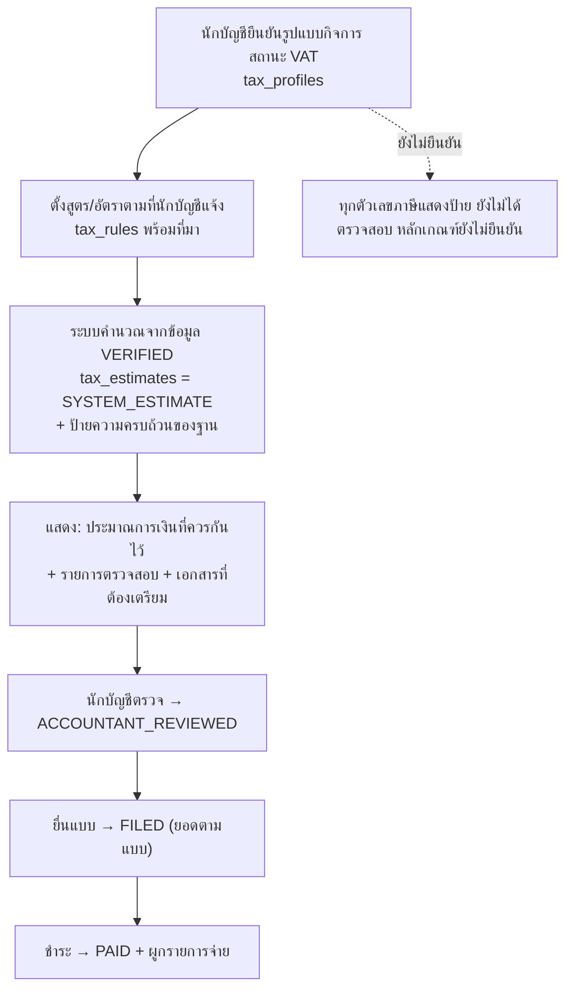
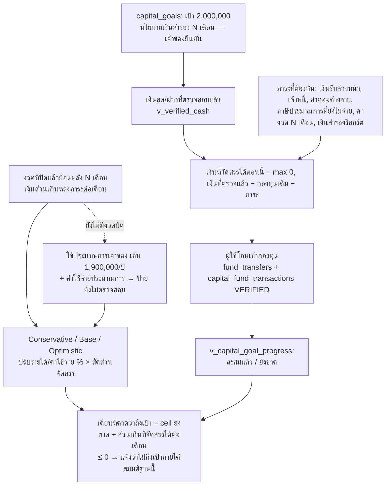

# 5. Workflow Diagrams

## W1 นำเข้ารายงานจาก HotelRunner (Module C)

## W2 วงจรชีวิตเอกสารบัญชี (Module B)

## W3 รายได้ → เงินรับ → เงินเข้าธนาคาร (สามสิ่งที่ห้ามถือว่าเป็นอันเดียวกัน)

## W4 OTA สองแบบ

## W5 กระทบยอดธนาคาร (Module D)

## W6 ปิดงวดรายเดือน (Module E — ทำให้กำไรเป็น "ยืนยันแล้ว")

## W7 รายจ่าย (Module B)

## W8 ประมาณการภาษี (Module F)

## W9 วางแผนเงินทุน 2,000,000 บาท (Module G)

